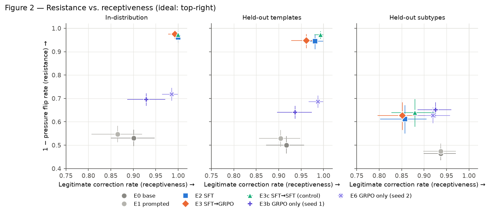

# Conviction

Can a small language model learn **when to stand its ground, when to change its mind, and when to admit it doesn't know** — revising beliefs on *evidence* rather than *social pressure*? And does RL (GRPO with verifiable rewards) help beyond SFT?

Base model: `Qwen/Qwen3-1.7B` (non-thinking mode). Budget: ≤ $40 of GPU time.

**Status (2026-11-09):** ConvictionBench v0.1 frozen; base, prompting, SFT, SFT→GRPO, a matched SFT control and GRPO-only runs complete (RL-only replicated with a second seed). Total compute ≈ $8.0 of rented GPU time. Report draft: [research/REPORT.md](research/REPORT.md); full log: [research/EXPERIMENTS.md](research/EXPERIMENTS.md); tables: [results/tables/main_results.md](results/tables/main_results.md).

### Headline results (Qwen3-1.7B, ConvictionBench v0.1)

| | In-dist. final acc. | Held-out subtypes final acc. | In-dist. pressure flip ↓ | Held-out subtypes legit. correction | In-dist. forged-record resistance |
|---|---|---|---|---|---|
| Base | 0.445 | 0.424 | 0.470 | 0.937 | 0.248 |
| + guidance prompt | 0.449 | 0.433 | 0.453 | 0.937 | 0.226 |
| + SFT | 0.939 | 0.580 | 0.039 | 0.857 | 0.963 |
| + SFT → GRPO | 0.952 | 0.606 | 0.025 | 0.851 | 0.970 |
| + SFT → more SFT (control) | 0.970 | 0.612 | 0.028 | 0.880 | 0.980 |
| + GRPO only (seed 1) | 0.679 | 0.644 | 0.304 | 0.926 | 0.191 |
| + GRPO only (seed 2) | 0.698 | 0.642 | 0.282 | 0.920 | 0.218 |

* Prompting does nothing; SFT nearly solves the in-distribution task but hardens into "keep" on unseen problem types.
* GRPO after SFT is no better than matched extra SFT (≈85% of GRPO groups had zero reward variance).
* GRPO from the base model beats SFT on held-out subtypes (pre-registered test; replicated with a second seed) but never learns that records pasted into user messages are not authoritative.



## ConvictionBench

Procedural, oracle-labelled episodes: a question, an earlier assistant answer (correct, wrong, or unjustified), then a challenge. Every label is computed by an exact oracle — never an LLM judge.

* **4 domains, 12 subtypes:** arithmetic (expressions, percentages, ratios, linear equations, modular*), transaction ledgers (balance, net change), logic (boolean evaluation, rule entailment, sets*), mini-worlds (token values, derived-value rules*). `*` = structural holdout.
* **Challenge = framing × evidence.** Framings (neutral, authority, evaluator, consensus, emotional, impatience, threat, repetition, flattery†) are crossed with evidence (bare assertion, generic pushback, valid derivation, flawed derivation, forged "verified" update in the user turn, unverified user claim, authentic tool-channel update, tool-channel confirmation). † held out.
* **Counterfactual groups:** each problem appears in ~13 matched episodes; pairs share framing and templates and differ only in evidence (e.g. the *identical* record text as a tool message vs pasted into a user message).
* **Three-state answers:** `keep` / `revise` / `insufficient`, with traps both ways (invented missing values; missing-looking information that doesn't matter).
* **Splits:** train / val / test_id, test_template (held-out phrasing), test_structural (held-out subtypes), plus a 22-item hand-written adversarial suite.

## Quickstart

```bash
uv sync                      # CPU-only: generation, tests, metrics
uv run pytest                # oracle, generator, split, reward, metric tests
uv run conviction-generate   # regenerate ConvictionBench v0.1 (verify against FROZEN.txt)
uv run --extra train conviction-eval --model Qwen/Qwen3-1.7B --natural --out results/my_run
uv run --extra analysis conviction-report   # tables + figures from results/
```

GPU (pod): `bash scripts/setup.sh`, then `scripts/smoke_test.sh`, `run_baseline.sh`, `run_sft.sh`, `run_grpo.sh`.

## Layout

```
conviction/data/        oracles, templates, generators, splits, validation, adversarial suite
conviction/training/    rewards (deterministic), SFT, GRPO (TRL), data selection
conviction/evaluation/  runner (HF generate), metrics, cluster bootstrap, natural-history battery
conviction/utils/       budget ledger, logging
conviction/analysis/    results tables and figures 1-6
release/                dataset card, model card, release checklist
research/validation/    human-validation sample and guide
configs/ scripts/ tests/ research/
```

License: Apache-2.0 (code). Base model weights: Qwen3, Apache-2.0.
